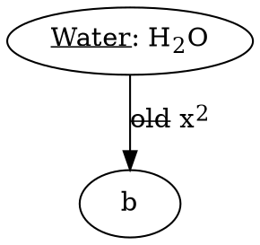
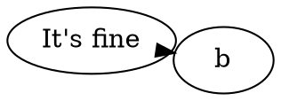

# Repository audit and HTML label review

Date: 2026-10-10. A01–A10 implemented; A11 automated checks implemented,
with Obsidian host compatibility verification still pending.

This audit covers application logic, worker lifecycle, SVG handling, build/release
configuration, tests, and documentation. Items have stable IDs so we can review
and implement them individually. An unchecked box means work remains.

## Overall assessment

The existing structure is appropriate for a small plugin: the Obsidian adapter,
settings, pure DOT/preamble helpers, and rendering code have clear responsibilities.
Keep this structure. There is no need for a framework, service layer, generalized
job system, or a separate HTML rendering engine for Graphviz-style labels.

Baseline validation (before implementation):

- `npm test`: all 11 existing tests passed.
- `npm run check`: TypeScript and version metadata checks passed.
- Production build run in a temporary workspace with the same sources and
  configuration: passed and produced `main.js`. The repository's generated bundle
  was not overwritten.
- Additional in-memory probes used the installed Graphviz WASM package
  (`@hpcc-js/wasm-graphviz` 1.27.3, reporting Graphviz 15.1.0), the actual DOT
  scanner and sanitizer, and a mock Worker/timer harness. No tests were added.

No Obsidian desktop/mobile session or actual GitHub release was exercised. Those
behaviors are marked as review/verification items rather than runtime-confirmed
failures. The findings below describe the baseline; each implementation note records
how the corresponding finding was addressed.

## Review queue

| Done | ID  | Priority | Area              | Finding / decision                                                        |
| ---- | --- | -------- | ----------------- | ------------------------------------------------------------------------- |
| [x]  | A01 | High     | Requested feature | Complete existing HTML-like label support (host visual check pending)     |
| [x]  | A02 | Medium   | DOT logic         | HTML text quotes can swallow the rest of the scan                         |
| [x]  | A03 | Medium   | DOT logic         | Valid layout syntax is rejected or missed                                 |
| [x]  | A04 | High     | Worker logic      | One timeout fails every queued diagram                                    |
| [x]  | A05 | Medium   | Lifecycle         | Disposal does not prevent later worker creation                           |
| [x]  | A06 | Medium   | Resource limits   | Limits start too late and do not bound the queue/output                   |
| [x]  | A07 | Medium   | Shared settings   | Existing diagrams have no explicit refresh path                           |
| [x]  | A08 | Medium   | SVG fidelity      | Sanitization removes gradient definitions                                 |
| [x]  | A09 | Low      | DOM integration   | Separate diagrams reuse the same SVG IDs                                  |
| [x]  | A10 | Low      | Documentation     | README links to files excluded from Git                                   |
| [ ]  | A11 | Medium   | Infrastructure    | Browser checks implemented; desktop/mobile/minimum-version checks pending |

Implementation validation:

- `npm test`: all 40 tests passed, including new renderer and adapter regressions.
- `npm run build`: passed, including TypeScript/version checks; rebuilt the local
  ignored `main.js` for use in a test vault.
- Offline headless Chromium smoke check: passed using the production worker build
  plugin. Verified actual Blob worker/WASM startup, recovery after invalid DOT,
  browser XML parsing, HTML labels/tables, gradients/scoped references, active
  cancellation with queued recovery, and permanent disposal.
- `git diff --check`: passed.
- Revalidated with the approved dependency upgrades, including TypeScript 7.0.2,
  Graphviz WASM 1.29.2, and Obsidian types 1.14.4. Node types are explicitly
  included in `tsconfig.json` for the test suite. Formatting checks, all 40 tests,
  the production build, and the offline browser smoke check pass on this set.
- No Obsidian desktop/mobile session or GitHub release was exercised. The README
  contains a manual host release checklist. No minimum-version/mobile claim was
  changed without host evidence.

All implementation work is approved. A11 remains unchecked specifically for host
verification; A01's implementation is complete, with its Obsidian visual check
included in that same pending release checklist.

## A01 — Complete HTML-like node and edge label support

**Implementation:** added value-restricted `baseline-shift` and `text-decoration`
support on SVG text, including overlines and combined decorations. Added real
WASM regression coverage for node/edge formatting, tables, ports, line breaks,
entities, and table links, plus rejection checks for unapproved formatting.
README examples cover node/edge labels and tables. Existing image/foreign-content
filtering remains covered. Verification: all 16 tests pass, `npm run build`
passes (including TypeScript and version checks), and `git diff --check` passes.
Visual checks in Obsidian with and without vault CSS still require a host session.

**Evidence:** reproduced through real WASM output and `sanitizeSvg`.
**Location:** `src/rendering/svg.ts:18`; documentation in `README.md`.

Yes, this is possible. Basic support already exists: DOT reaches Graphviz without
label conversion, and Graphviz turns HTML-like labels into SVG. Bold, italic,
line breaks, and ordinary table geometry fit the current rendering approach.
However, the sanitizer strips `text-decoration` and `baseline-shift`, losing
`<U>`, `<S>`, `<SUB>`, and `<SUP>` formatting on both nodes and edges.

Reproduction:



The raw SVG contains `text-decoration="underline"`, `text-decoration="line-through"`,
`baseline-shift="sub"`, and `baseline-shift="super"`; sanitization removes them.

**Decision:** recommend Graphviz's HTML-like subset. Arbitrary browser HTML/CSS
(such as styled `<div>` elements) would require a separate design and sizing
strategy. Graphviz's syntax is modeled on HTML but has its own grammar; see the
[official HTML-like label reference](https://graphviz.org/doc/info/shapes.html#html).

**Smallest change:** preserve the specific formatting attributes/values emitted
by Graphviz, retain sanitization, and document angle-bracket label syntax. Add
node and edge examples, including a table. No new rendering dependency needed.

**Acceptance:** verify formatting survives sanitization on nodes and edges,
tables/ports and `<BR/>` work, XML entities render correctly, and unsafe links,
event handlers, images, and foreign content remain filtered. Check appearance in
Obsidian with and without the user's CSS snippet.

## A02 — Quotes in HTML text confuse the DOT scanner

**Implementation:** The HTML scanner now tracks tag context, so quotes in ordinary text do not
start an attribute string. HTML IDs are retained as tokens. Regression cases
cover apostrophes, text quotes, nested tags, quoted `>` attributes, and HTML graph
names. The browser smoke check also exercises an HTML graph name.

**Evidence:** reproduced against the scanner and real WASM.
**Location:** `src/core/dot.ts:182`.

`afterHtmlString` treats every apostrophe or quotation mark as an attribute quote,
including ordinary label text. An unmatched text apostrophe makes it skip the
remaining source:



Graphviz accepts this, but `scanDot` reports no layout. More visibly,
`digraph <It's a graph> { a -> b }` is accepted by Graphviz but produces
`bodyBrace: -1`, so the plugin never inserts the configured preamble.

**Smallest change:** distinguish text from quoted tag attributes while skipping
HTML strings; keep this a focused lexer helper.

**Acceptance:** cover apostrophes and quotes in text, quoted attributes containing
`>`, nested tags, and HTML graph IDs. Verify both preamble insertion and layout
selection. Graphviz can still honor a missed layout itself; do not assume every
scanner miss changes the actual diagram layout.

## A03 — Other valid DOT layout forms disagree with the scanner

**Implementation:** The lexer removes LF/CRLF escaped line continuations, preserves other DOT
escapes, accepts HTML-string attribute IDs/values, and keeps the graph role
across repeated attribute lists. Tests cover selection, unsupported values,
precedence, and exclusion of node/edge/subgraph lists.

**Evidence:** reproduced against the scanner and real WASM.
**Location:** `src/core/dot.ts:59`, `:85`, `:141`.

Three cases need a compatibility decision:

1. A quoted layout continued with backslash + newline is valid DOT, but the
   scanner retains the newline and the plugin rejects the engine:

   ```dot
   digraph { layout="ne\
   ato"; a -> b }
   ```

2. `graph [rankdir=LR][layout=neato]` is valid, but only the first attribute list
   is recognized as graph attributes.
3. `layout=<neato>` is a valid HTML-string attribute value, but HTML strings are
   discarded entirely by tokenization. Unsupported values in this form also
   bypass the plugin's explicit engine validation.

The [official DOT grammar](https://graphviz.org/doc/info/lang.html) permits
continued quoted strings, repeated attribute lists, and HTML-string IDs.

**Smallest change:** align the existing lexer/attribute-list handling with these
forms, or explicitly document a narrower supported subset. Avoid expanding this
into a complete DOT parser.

**Acceptance:** valid forms select the same engine, later assignments still win,
and node/edge/subgraph attributes remain excluded. Preserve accurate unsupported
engine errors.

## A04 — A slow diagram causes unrelated diagrams to fail

**Implementation:** Timeout now rejects only the active job, terminates/revokes its worker, and
dispatches retained jobs to a fresh worker. Tests cover queued recovery, stale
callbacks, normal syntax errors, and cleanup. Startup/transport failures still
fail the queue once; later renders may retry without an automatic restart loop.

**Evidence:** reproduced with the actual renderer and mock Worker/timers.
**Location:** `src/rendering/renderer.ts:93`, `:103`.

Queue a slow diagram followed by a valid small diagram. Only the first is sent
to the worker. Its timeout calls `failAll`, rejecting both with the same timeout
message, although the second never ran. This conflicts with the README's promise
that an erroneous block leaves the rest of the note alone.

**Smallest change:** separate failure of the active job from disposal of the
whole renderer. After terminating a timed-out worker, retain queued jobs and
dispatch them to a new worker. Decide separately how startup failures should
behave to avoid endless retries.

**Acceptance:** the slow job fails, subsequent jobs render, the old worker and
Blob URL are released, and plugin unload still rejects all outstanding work.

## A05 — Unload can be followed by a new worker

**Implementation:** Renderer disposal is permanent. Each Obsidian block owns a
`MarkdownRenderChild` and AbortController, cancels when removed/refreshed, and
guards asynchronous DOM updates. Plugin unload stops the renderer and blocks.
Tests cover unload during preamble reads, removal during rendering, and late
results; the real browser test covers cancellation/restart and disposal.

**Evidence:** `render()` after `dispose()` creates another worker in a mock
harness; the triggering Obsidian timing remains to be verified.
**Location:** `src/main.ts:32`, `:49`; `src/rendering/renderer.ts:29`, `:53`.

The adapter awaits a preamble read before calling the renderer. If the plugin
unloads during that read, `dispose()` runs first; the continuation can then call
`render()` and recreate a worker. There is no disposed flag. Individual block
removal also has no cancellation hook, so detached blocks can keep queued work.

**Smallest change:** make final disposal permanent and connect render lifetime
to the host's block lifecycle. Guard asynchronous DOM updates after disposal or
block removal. Use existing Obsidian lifecycle facilities where practical.

**Acceptance:** simulate unload during preamble reading and during layout;
neither creates a later worker or updates a disposed block. Close a note with
queued diagrams and verify unnecessary work is removed.

## A06 — Resource protections leave work on the UI thread unbounded

**Implementation:** Shared limits are checked before initial scanning, before preamble
extraction, before scanning combined DOT, before worker dispatch, and before SVG
DOM parsing. Pending work is capped at 64 jobs / 1,000,000 UTF-16 units including
the active job; SVG is capped at 5,000,000 units. Worker output is checked before
posting and again at the receiving boundary. Tests cover oversize source,
preamble, combined DOT/output, queue count/total input, and released capacity.
These conservative bounds are documented; host stress testing remains manual.

**Evidence:** code inspection; no stress benchmark performed.
**Location:** `src/main.ts:48`; `src/rendering/renderer.ts:29`, `:42`;
`src/rendering/svg.ts:104`.

The 250,000-character check runs after DOT tokenization, preamble reading and
concatenation, and a second tokenization. Oversized input therefore incurs UI
thread work before rejection. Each queued request is limited, but the queue's
total retained input is not. SVG output is parsed, traversed, and imported on the
UI thread without a size bound; keeping layout in a worker alone does not
guarantee that a large diagram cannot freeze the interface.

**Smallest change:** reject oversized source before scanning and check combined
input before the second scan. Decide on a modest queue and SVG-output limit,
with clear errors; use cancellation from A05 to reduce obsolete work.

**Acceptance:** oversized source never reaches scanning/worker dispatch;
oversized combined input and output fail clearly; a many-block note remains
usable. Choose thresholds from ordinary diagrams rather than arbitrary tuning.

## A07 — Preamble/settings changes do not explicitly refresh diagrams

**Implementation:** Added **Graphviz Plus: Refresh diagrams**, which rereads the preamble and
settings for registered blocks and cancels obsolete renders. Chose explicit
refresh rather than automatic vault event tracking. README documents refresh,
reopening notes, and updating the configured path after renames. Adapter tests
verify the command uses changed preamble text/settings and excludes removed blocks.

**Evidence:** code inspection; visible Obsidian behavior requires manual review.
**Location:** `src/main.ts:24`, `:98`; `src/settings.ts` change handlers.

The plugin reads the preamble when a block renders and saves settings when they
change, but subscribes to neither preamble modifications nor a refresh trigger.
An already displayed diagram can therefore retain old defaults until Obsidian
rerenders it. Renaming a configured path may also leave a stale setting.

**Decision:** either document reopening/rerendering as the expected workflow or
add a simple refresh command. Automatic refresh on preamble/settings changes is
optional and should not require an elaborate dependency tracker.

**Acceptance:** edit the preamble, change the engine setting, and rename the
preamble note while a diagram is visible; verify the agreed refresh behavior.

## A08 — Gradient fills become dangling references

**Implementation:** Allowed a narrow set of linear/radial gradient elements and attributes.
Graphviz stop styles are converted into validated color/opacity attributes;
arbitrary styles are still removed. Paint URLs must target a retained local
gradient. Tests cover both gradient types, converted stops, dangling/external
references, and arbitrary styles. Real-browser gradient parsing also passes.

**Evidence:** reproduced through real WASM and the sanitizer.
**Location:** `src/rendering/svg.ts:3`.

`digraph { a [style=filled, fillcolor="red:blue"] }` emits a `linearGradient`
definition and an ellipse with `fill="url(#node1_l_0)"`. Sanitization removes the
definition (and its `defs` container), but leaves the fill reference. The normal
Graphviz gradient cannot render correctly.

**Decision:** either support a narrow set of gradient definitions and local
references, or document gradients as unsupported and avoid dangling references.
If supported, coordinate with A09. Do not broadly enable external paint URLs.

**Acceptance:** verify linear/radial fills as applicable and safe reference
handling, including two diagrams in one document.

## A09 — SVG IDs collide between diagrams

**Implementation:** Every retained ID receives a per-render prefix and unique element index;
local hrefs and gradient paint references are rewritten together. External URLs
and fragment links without a diagram target retain their existing behavior.
Tests verify separate diagrams, duplicate source IDs, and local links. Browser
checks verify local references resolve within their intended diagram. README
recommends classes as stable CSS selectors.

**Evidence:** two independently rendered diagrams both emit `graph0`, `node1`,
`node2`, and `edge1`; browser fragment behavior needs host verification.
**Location:** `src/main.ts:66`; `src/rendering/svg.ts:29`, `:66`.

Inline SVG retains Graphviz-generated and user-supplied IDs without a per-render
prefix. Multiple diagrams introduce duplicate document IDs. Fragment links and
ID selectors can consequently resolve to another diagram; supporting gradients
would add more reference collisions.

**Smallest change:** if fragment/reference features matter, prefix IDs per
render and rewrite corresponding local references. Decide whether links to
external note anchors should remain untouched.

**Acceptance:** render two diagrams with repeated IDs and confirm local links
and supported paint references target the intended diagram.

## A10 — Documented examples are absent from a checkout

**Implementation:** Chose self-contained README examples rather than publishing ignored
personal files. Replaced the unavailable CSS file instruction with an inline
snippet, removed unavailable pathway/example-directory references, and updated
the source tree/development instructions and stylesheet comment. Existing
ignored local examples/docs remain personal files.

**Evidence:** `git ls-files` and `.gitignore` inspection.
**Location:** `.gitignore`; README CSS styling and pathway sections.

The README directs readers to `examples/graphviz.css`, `examples/diagrams/`, and
`docs/diagram-conventions.md`, but these directories are ignored and none of the
referenced files are tracked. Local copies do not make them available to someone
cloning the repository.

**Smallest change:** review and track the intended examples/docs, or remove the
unavailable links and provide self-contained examples in the README.

**Acceptance:** follow every local README link from a clean checkout. Include
the HTML label examples from A01 in a tracked location.

## A11 — Infrastructure checks do not exercise the delivered browser worker

**Implementation:** Added renderer queue/lifecycle and adapter tests, plus an offline
headless browser smoke runner using the same minified embedded-worker plugin as
the release. CI and release workflows run it using preinstalled Chrome. The
worker build now watches all bundled inputs, including the shared limits helper.
Production build context is disposed cleanly. A manual browser output mode and
a desktop/mobile/minimum-version release checklist are documented.
Prettier is recorded in the dependency lockfile. The tracked pre-commit hook runs
formatting and TypeScript/version checks, installs through npm's prepare script,
and preserves existing custom hook paths. CI/release also check formatting.

**Remaining:** run the README checklist in actual Obsidian desktop, mobile, and
1.5.0 test vaults and record versions/results here. Browser success alone does
not establish those compatibility claims. No host session was available in this
workspace; the existing manifest compatibility declarations remain unverified.

**Evidence:** test/build/workflow inspection. Current checks pass.
**Location:** `tests/worker.test.ts`; `scripts/run-tests.mjs`;
`esbuild.config.mjs`; `.github/workflows/ci.yml`; `manifest.json`.

The worker test bundles the worker for Node and supplies a mocked `self`. It
does not instantiate `GraphvizWorkerRenderer`, create a Blob worker, or execute
the browser-targeted embedded bundle that ships. The release build verifies
bundling succeeds, but not runtime initialization, offline loading, timeout
recovery, or compatibility with the advertised Obsidian 1.5.0 minimum/mobile
support. The failure paths in A04/A05 currently have no regression coverage.

**Smallest change:** add focused renderer queue/lifecycle tests when fixing those
bugs. Maintain a short manual release check in a test vault for desktop/mobile,
offline worker startup, HTML labels, and plugin unload/reload. Add one automated
browser smoke test only if its maintenance cost is justified.

**Acceptance:** exercise the actual production bundle offline in supported hosts;
verify minimum-version claims or adjust them based on evidence. Confirm a bad
diagram followed by a good one recovers. Continue using the existing lockfile,
CI checks, and three-file release layout; no replacement infrastructure is
indicated by this audit.
