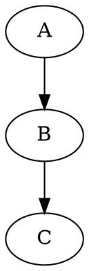
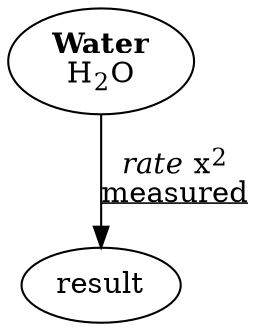
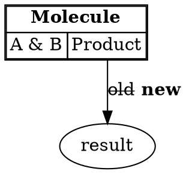
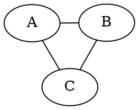

# Graphviz Plus

An Obsidian plugin that renders graphviz diagrams written in DOT, the graphviz
graph description language.

Note: written with the assistance of Claude Code; note that this has not been
robustly tested, and is only meant as a plugin for my personal use. However,
please feel free to open a feature request or submit a pull request if it is
lacking.

## Details

The plugin runs graphviz as WebAssembly in a Web Worker. There's no need to
install graphviz on your machine, and the manifest enables both desktop and
mobile. Host compatibility still needs verification in a test vault. Layout
runs in a worker, and input/output limits bound the parsing work on the Obsidian
interface thread.

Two features beyond rendering:

- **a shared preamble**: there is a setting in which you can set your default
  styles; the plugin prepends it before every diagram
- **CSS control**: the plugin puts the SVG in the page rather than inside an
  `` element, so a CSS snippet can select nodes and edges and set colors
  for all diagrams at once

## Installation

**BRAT** is a community obsidian plugin that installs a plugin from a github
release and keeps it up to date. It can be used to get the same version on every
machine.

1. install the community plugin **Obsidian42 - BRAT**
2. in BRAT, select **Add beta plugin**
3. enter this repository's github URL, then click **Add**
4. open **Settings > Community plugins** and turn on **Graphviz Plus**

## Example

Write a fenced code block and mark it `dot`:

````markdown

````

In obsidian: the block renders in Reading view; in Live Preview, it renders once
you move the cursor out of the block.

Apart from inserting the preamble and selecting the layout engine described
below, the plugin passes the block to graphviz as you wrote it. Standard drawing
features work: node shapes, `subgraph cluster_...` containers, `arrowhead=...`,
HTML-like labels, etc. Active SVG content and embedded images are deliberately
removed from the result; safe `http`, `https`, `mailto`, `obsidian`, and local
fragment links are retained.

The plugin uses the `dot` code fence; hopefully this does not break other
plugins (but if it does, please feel free to open a PR).

## HTML-like labels

Nodes and edges can use Graphviz's HTML-like label syntax. Enclose the label in
angle brackets rather than quotes: `label=<<B>bold</B>>`. The outer pair delimits
the DOT string; the inner tags format its contents.



Supported text formatting includes `<B>`, `<I>`, `<U>`, `<O>` (overline), `<S>`
(strike-through), `<SUB>`, `<SUP>`, `<FONT>`, and `<BR/>`. Tables can form node
labels and provide named ports for edges:



Use XML entities such as `&amp;`, `&lt;`, `&gt;`, and `&quot;` for literal special
characters, and double quotes for tag attribute values. Use `<BR/>` for a visible
line break; source newlines only format the DOT. Prefer `shape=plain` for table
nodes over record shapes. See the
[Graphviz label grammar](https://graphviz.org/doc/info/shapes.html#html) for details.

Graphviz supports its own HTML-like subset, rather than arbitrary browser HTML
or CSS. Labels become SVG text and shapes, so vault CSS snippets can override
their presentation. Embedded images are removed, and links follow the same URL
policy as other diagram links. Linear and radial gradient fills are supported.

## Layout engines

A layout engine is the algorithm that decides where nodes and edges go.
Graphviz ships several, and they suit different graph shapes:

| engine      | layout                                | use for                             |
| ----------- | ------------------------------------- | ----------------------------------- |
| `dot`       | hierarchical, nodes assigned to ranks | cascades and other DAGs             |
| `neato`     | spring model, by stress majorization  | small interaction networks          |
| `fdp`       | spring model, by force reduction      | medium interaction networks         |
| `sfdp`      | `fdp` with a multilevel solver        | large interaction networks          |
| `circo`     | circular                              | networks built from cycles          |
| `twopi`     | radial, around one root node          | trees with a single centre          |
| `osage`     | clusters packed into an array         | graphs that are mostly clusters     |
| `patchwork` | squarified treemap                    | trees where node area shows a value |

Set the engine for one block with the `layout` attribute, quoted or unquoted:



The attribute must be in the outer graph scope, either as `layout=neato` or
`graph [layout=neato]`. A node, edge or subgraph attribute named `layout` does
not select the engine. If the outer graph assigns it more than once, the last
assignment wins, just like other DOT attributes. Unsupported engines produce a
clear error rather than silently falling back to a different layout.

Blocks that set no `layout` attribute use the engine from **Settings -> Graphviz
Plus -> Default layout engine**.

## Shared preamble

DOT has no include directive, so shared styles would otherwise be copied into
every block. Instead, put them in one note and name that note in the settings.

1. Create a note, for example `graphviz-preamble`.
2. Open **Settings -> Graphviz Plus**.
3. Enter the note's name or vault path in **Preamble note**.

The note holds either raw DOT or a fenced block marked `dot` or `graphviz`, or
marked with nothing. When it holds several fenced blocks, the plugin uses the
first block that carries one of those marks and ignores the rest. Example
contents:

```
rankdir=LR; bgcolor="transparent";
node [shape=box, style="rounded,filled", fontname="DejaVu Sans"];
edge [fontname="DejaVu Sans", arrowsize=0.8];
```

The plugin inserts this text directly after the `{` that opens the graph body,
where graph, node and edge attribute statements are legal. So the note holds
statements, not a whole graph: no `digraph { … }` wrapper.

If a note contains fenced blocks but none is blank or marked `dot` or
`graphviz`, the plugin inserts nothing. This prevents Markdown prose and
unrelated code samples from being sent to Graphviz as though they were DOT.

A block can still override anything the preamble sets, because the block's own
statements come after it.

Leave **Preamble note** empty to insert nothing. The settings tab reports
whether the path you entered refers to a note. If it doesn't refer to anything,
the plugin renders diagrams without a preamble.

After changing the preamble or settings, run **Graphviz Plus: Refresh diagrams**
from the command palette to update displayed diagrams. Reopening a note also
uses the current settings. Changes do not automatically refresh existing blocks.
If you rename the preamble note, update its configured path before refreshing.

## CSS styling

Obsidian supports stylesheets, so that a style can be applied to the entire
vault. Because the plugin puts the SVG in the page, a snippet can reach the
graph and set its colors.

1. Create `<vault>/.obsidian/snippets/graphviz.css` with the CSS below.
2. Turn it on under **Settings -> Appearance -> CSS snippets**.

```css
.graphviz-plus g.node :is(ellipse, circle, rect, polygon, path) {
  fill: var(--background-secondary);
  stroke: var(--text-normal);
}
.graphviz-plus g.node text,
.graphviz-plus g.edge text {
  fill: var(--text-normal);
}
.graphviz-plus g.edge path {
  stroke: var(--text-muted);
}
.graphviz-plus g.edge polygon {
  fill: var(--text-muted);
  stroke: var(--text-muted);
}
.graphviz-plus g.complex :is(ellipse, circle, rect, polygon, path) {
  fill: #e8f3ec;
  stroke: #3a7d4f;
}
```

Give a node a class in DOT to pick its color:

```dot
IKK [class="complex", shape=box, label=<<B>IKK</B><BR/>IKKα / IKKβ / NEMO>]
```

SVG IDs are scoped separately for each rendered diagram. Use DOT classes for
stable CSS selectors. The example snippet overrides DOT colors, including table
cell colors and gradient fills, because SVG presentation attributes have lower
priority than CSS rules. It preserves HTML-like text formatting.

Keep each color in one place: either in the DOT source, which renders the same
everywhere, or in the snippet, which applies across the vault. Setting a color
in both makes the DOT value unused.

## Settings

- **preamble note**: the note whose DOT the plugin inserts into every block;
  empty means no preamble
- **default layout engine**: the engine used by a block that sets no `layout`
  attribute; one of `dot`, `neato`, `fdp`, `sfdp`, `circo`, `twopi`, `osage` or
  `patchwork`; default is `dot`

## Errors

The plugin prints a DOT error inside the block and leaves the rest of the note
alone. For example, the erroneously structured block `digraph { A -> }` prints:

```
Graphviz error:
syntax error in line 1 near '}'
```

Graphviz accepts many unknown attributes without an error, but invalid syntax
and some invalid attribute values produce errors. Unsupported layout engines
are rejected explicitly by the plugin.

The plugin limits DOT source, preamble note text, and combined input to 250,000
characters each. It allows at most 64 pending diagrams and 1,000,000 total
characters of pending input, including the active diagram. A full queue reports
an error; use **Graphviz Plus: Refresh diagrams** after pending layouts finish.
Rendered SVG is limited to 5,000,000 characters before UI-thread parsing.
Character counts use JavaScript string length (UTF-16 code units).

A layout that exceeds 15 seconds terminates its worker; queued diagrams continue
in a fresh worker. Removing a block cancels its work, and plugin unload cancels
all outstanding work. Worker startup/communication failures fail pending jobs
without repeated restart attempts; a later render can try again.

Before insertion, generated SVG passes through a strict allowlist. Event
handlers, arbitrary inline styles, foreign elements, embedded images and unsafe
link protocols such as `javascript:`, `data:` and `file:` are removed. Graphviz's
gradient stop styles are converted into presentation attributes, and paint URLs
must reference a retained local gradient. XML parsing itself is not sanitization.

## Development

Production TypeScript lives under `src/`, separated by responsibility:

```text
src/
├── main.ts                  # Obsidian lifecycle, settings and DOM integration
├── settings.ts              # Settings model and settings-tab UI
├── core/
│   ├── dot.ts               # DOT tokenization and engine selection
│   ├── preamble.ts          # Markdown preamble extraction
│   └── limits.ts            # Input, queue and output bounds
├── rendering/
│   ├── renderer.ts          # Worker queue, limits and cancellation
│   ├── graphviz.worker.ts   # Graphviz WASM worker entry point
│   └── svg.ts               # SVG validation and sanitization
└── types/
    └── worker-source.d.ts   # Type for the build-time virtual module
```

Tests stay in `tests/`, and build/release utilities in `scripts/`. Examples are
in this README so they are available in a clean checkout. Package,
Obsidian manifest, license and build configuration files remain at the project
root, as is conventional for Node packages. The build still emits `main.js` at
the root because Obsidian expects that release asset there.

```bash
npm ci
npm run dev   # esbuild rebuilds main.js on every save
npm test      # adversarial unit/integration tests
npm run check # type-check and validate release-version metadata
npm run format # format project source, tests, scripts and documentation
npm run lint   # check formatting, TypeScript and version metadata
npm run test:browser # offline smoke check; requires Chromium/Chrome on PATH

# Load the plugin from a test vault, to avoid conflicts with the installation
# vault:
ln -s "$PWD" "<test-vault>/.obsidian/plugins/graphviz-plus"
```

Then turn the plugin on, under **Settings -> Community plugins**. The community
plugin **Hot-Reload** (`pjeby/hot-reload`) reloads it after each rebuild, which
saves you the "Reload app without saving" command.

`npm run build` type-checks the source and writes the `main.js` that ships in a
release.

`npm ci` also enables the tracked `.githooks/pre-commit` hook locally. Each commit
runs `npm run lint`: Prettier checks formatting, followed by TypeScript and
release-version checks. Run `npm run format`, review the diff, and stage the
formatted files before committing. Generated `main.js`, the lockfile, and ignored
personal examples/docs are excluded from Prettier. CI skips hook installation
and runs the formatting check directly. Existing custom Git hook paths are
preserved; add `npm run lint` to your existing pre-commit hook in that case.
Use `npm run hooks:install` to enable the tracked hook again if needed.

### Release

BRAT reads the assets of the latest github release, so the repository needs at
least one release that carries `main.js`, `manifest.json`, and `styles.css`. The
workflow in `.github/workflows/release.yml` builds and attaches those three
files when you push a tag.

To install without BRAT, copy those same three files into
`<vault>/.obsidian/plugins/graphviz-plus/`.

### Tests and release checks

Tests use Node's built-in test framework. TypeScript tests are bundled into a
temporary directory with the project's pinned esbuild, run under Node, and
removed afterward, so the repository stays clean and no test-only loader is
needed. The suite emphasizes behavioral boundaries: DOT scope and precedence,
comments and HTML labels, fenced-note selection, SVG formatting/gradients and
URL policies, worker timeout/cancellation/queue bounds, and Obsidian adapter
lifecycle/refresh behavior using a minimal host double.

`npm run test:browser` builds the same minified embedded browser worker as the
release and runs it in headless Chrome with networking disabled. It verifies
WASM startup, invalid-DOT recovery, HTML labels, browser SVG parsing, gradients,
scoped references, cancellation recovery, and disposal. Set `GRAPHVIZ_CHROME` to
your Chrome/Chromium executable if it is not named `chromium`. To inspect the
result visually, run `npm run test:browser -- --manual` and open the printed
local file in a browser with networking disabled. The manual file stays in a
temporary directory for inspection.

CI runs tests, the production build, and the offline browser smoke check for
pushes and pull requests. Releases run
the same checks and additionally require the Git tag (with an optional `v`
prefix) to match `manifest.json`; `package.json`, `manifest.json`, and
`versions.json` must agree as well. Add a regression test before fixing any
future parser or sanitizer bug, and prefer testing observable behavior over
private implementation details.

### Manual host release checks

The manifest declares Obsidian 1.5.0 as its minimum and enables mobile. The
browser smoke test does not establish compatibility with those hosts. Before
publishing, record the actual versions/platforms tested in `AUDIT.md`:

- In desktop and mobile test vaults, render plain DOT, HTML node/edge labels,
  tables/ports, linear/radial gradients, and two diagrams with local links.
- Repeat with networking disabled, then with the README CSS snippet enabled;
  verify colors, label formatting, and links behave as intended.
- Edit the preamble and default engine, run **Refresh diagrams**, and confirm the
  visible diagrams update. Rename the preamble, update its path, and refresh.
- Remove a block while rendering, close its note, and disable/re-enable the
  plugin during layout. Verify no stale updates and that new diagrams render.
- On Obsidian 1.5.0, verify worker startup, Live Preview, Reading view, and these
  lifecycle behaviors. If that version fails, raise the minimum based on the
  tested version and update `versions.json` accordingly.

## License

MIT. See `LICENSE`.
